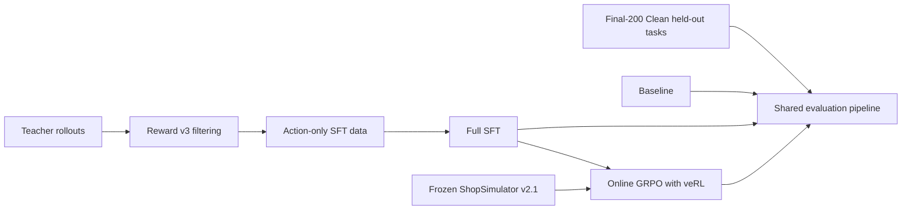
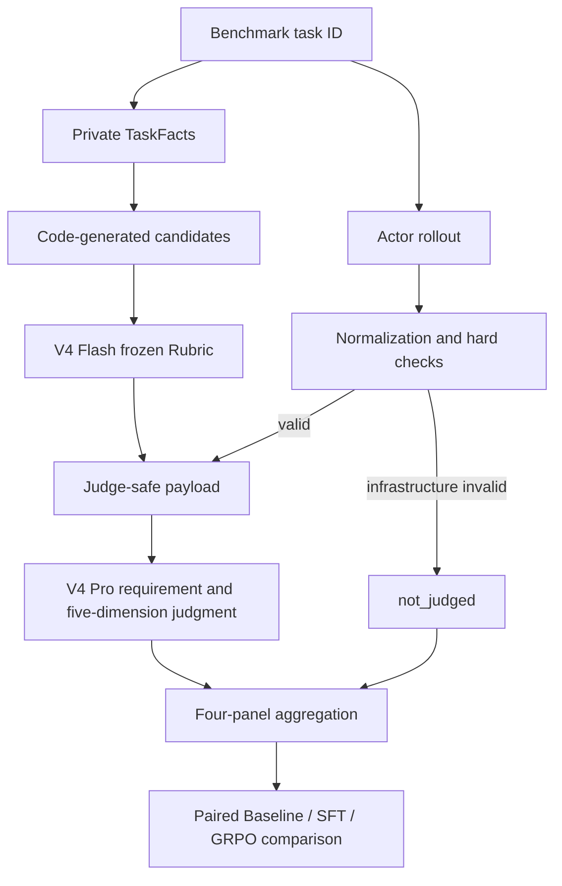

# Shopping GRPO

<div align="center">

**English** · [简体中文](README.md)

<br />

Reproducible post-training and evaluation for long-horizon shopping agents

<br />

[](pyproject.toml)
[](docs/sft.md)
[](https://github.com/verl-project/verl)
[](https://arxiv.org/pdf/2601.18225)
[](docs/evaluation-dataset.md)

<br />

Teacher rollouts and full SFT → online GRPO with veRL → auditable comparison on
a frozen benchmark

</div>


## What is ShopSimulator?

[ShopSimulator](https://arxiv.org/pdf/2601.18225) is a large-scale Chinese
shopping environment for evaluating long-horizon LLM agents. A task describes
what a user wants—including category, budget, brand, model, functions and
product options—but the agent must discover the right item through interaction.

In this project the agent can search products, open candidates, inspect details,
select variants, buy, or stop when no acceptable item can be verified. Success
therefore requires more than producing a plausible answer: the agent must gather
evidence, obey constraints, choose the correct variant and terminate correctly.

The frozen Environment v2.1 source and product archive are embedded under
[`environments/ShopSimulator/`](environments/ShopSimulator/), so the tutorial
does not depend on a separately running third-party repository.


## The four stages

| Stage | What happens | Entry point | Details |
|---|---|---|---|
| Baseline | Evaluate the untouched base model | `bash scripts/baseline.sh` | [Evaluation](docs/evaluation.md) |
| SFT | Learn tool use from accepted teacher trajectories | `bash scripts/sft.sh` | [SFT](docs/sft.md) |
| GRPO | Optimize terminal Reward v3 with online rollouts | `bash scripts/grpo.sh` | [GRPO](docs/grpo.md) |
| Evaluation | Run the curated Final-200 Clean protocol | `bash scripts/evaluate.sh NAME` | [Evaluation](docs/evaluation.md) |

The checked-in SFT data was produced by a separate collection stage documented
in [Data collection](docs/data-collection.md). The custom constraint-aware
reward is specified in [Reward v3](docs/reward-v3.md).



### How the SFT data was collected

The current collection used `deepseek-v4-flash` as a teacher in ShopSimulator
Environment v2.1. It produced 2,498 raw trajectories, of which 1,026 passed the
strict acceptance filter. This frozen revision uses 1,000 trajectories split
into 800 training and 200 validation rows. SFT, GRPO and Final-200 Clean task IDs are
pairwise disjoint. Dataset hashes and the audit are in
[Data collection](docs/data-collection.md).

Fresh collection has two separate steps. Start ShopSimulator and export the
Teacher endpoint's `OPENAI_BASE_URL`, `OPENAI_API_KEY` and `OPENAI_MODEL` first:

```bash
python scripts/collect_sft_data.py \
  --task-range 0 5000 --limit 3000 \
  --output-dir outputs/sft-collection/raw \
  --workers 4

python scripts/clean_sft_data.py \
  --raw outputs/sft-collection/raw/raw.jsonl \
  --output-dir outputs/sft-collection/clean \
  --validation-ratio 0.2 --seed 42
```

Sampling retains all successes and failures and supports resume. Cleaning is
offline: it validates, sanitizes, deduplicates and splits the saved trajectories.
Both steps exclude Final-200 and the current GRPO task pool. See
[Data collection](docs/data-collection.md) for logs, resume and configuration.

### How GRPO is trained

GRPO starts from the merged SFT model. veRL generates four online trajectories
per prompt in ShopSimulator, while deterministic Reward v3 scores the terminal
purchase, constraint satisfaction and termination behavior. No additional
LLM-as-a-Judge reward model is used for training.

The repository pins `verl==0.8.0` instead of copying its source. It keeps only
the project-specific AgentLoop, tool adapter, runtime compatibility code and a
small SHA-256-checked patch. See the [GRPO guide](docs/grpo.md) for details.

### How evaluation works

Formal evaluation combines deterministic checks with two LLM-as-Judge roles.
DeepSeek V4 Flash curates a frozen requirement Rubric from code-generated
category, brand, model, function, option and price candidates. It may select and
deduplicate candidates, but cannot invent fields or expected values. The same
Rubric is shared by Baseline, SFT and GRPO.

After each Actor completes a rollout, code normalizes events and computes
Reward, legality, repetition, context and infrastructure checks. Valid
trajectories then go to DeepSeek V4 Pro with the original Query, frozen Rubric,
Actor-visible trajectory, neutral terminal flags and allowlisted behavioral
metrics. Reward values, hidden Gold fields, raw observations, success labels and
other models' results are excluded.



V4 Pro scores Search Strategy, Candidate Utilization, Evidence Verification,
Decision Quality and Termination Efficiency independently on a 0/1/2 scale. It
also assesses each Rubric and assigns errors from a frozen taxonomy. The final
report keeps Reward/terminal, requirement Rubric, trajectory quality and
deterministic behavior as four separate panels—there is no composite score.
Failed, missing and not-judged tasks remain in the Final-200 Clean denominator. The
[evaluation guide](docs/evaluation.md) contains the complete prompts, one
worked benchmark example, input-isolation rules and aggregation contract. An
historical static view is available in the [Final-200 Benchmark Dashboard](docs/evaluation-dashboard.html); the current task set is documented in [Final-200 Clean](docs/evaluation-dataset.md).

> **Reserved figure — Training and evaluation pipeline.** A full-width diagram
> showing teacher data collection, LoRA SFT, online GRPO rollouts and the shared
> held-out evaluation path, with artifacts produced at each boundary.

## Results

A contributor reproduction is now available on the current Final-200 Clean
benchmark. See the [evaluation update log](docs/evaluation-updates.md) for the
full protocol, failure distribution and artifact hashes:

| Model | Strict success | Purchase success | Done rate | Mean reward |
|---|---:|---:|---:|---:|
| Qwen3.8-27B (BF16 weights, thinking disabled) | 73.0% | 73.0% | 99.5% | 0.6354 |

The following are archived Final-200 results; new comparisons use Final-200 Clean:

| Model | Strict success | Purchase success | Mean reward |
|---|---:|---:|---:|
| Qwen3.5-2B baseline | 0.0% | 0.0% | -0.1105 |
| LoRA SFT | 60.5% | 60.5% | 0.4729 |
| GRPO step 100 | 62.0% | 62.5% | 0.5158 |

The complete compact summaries and reproduction settings are in
[`experiments/`](experiments/). These are reported results, not a promise that
different hardware or dependency versions will produce bit-identical training.

## Training hardware and time

All training used a single NVIDIA RTX 6000 with 96 GB of GPU memory.

### LoRA SFT training (448 training examples, 3 epochs)

| Stage | Time | Peak GPU memory |
|---|---:|---:|
| One epoch (56 steps) | ~62 min | 89 GiB |
| Full 3-epoch training | ~3 h | 89 GiB |

### GRPO training (veRL 0.8, 8 environment workers)

| Step range | Per-step time | Cumulative time |
|---|---:|---:|
| steps 0–24 | ~140 s/step, including Ray startup | ~56 min |
| stable steps 20–30 | ~73–120 s/step | ~2 min/step in the steady state |
| 100 steps (reported checkpoint) | ~110 s/step on average | ~3–4 h |
| Full 500 steps | ~100 s/step | ~14 h |

### Other stages

| Stage | Estimated time |
|---|---:|
| Teacher collection (2,498 raw trajectories) | Depends on endpoint concurrency and rate limits |
| Final-200 Clean evaluation (Base) | ~20 min |
| Final-200 Clean evaluation (SFT/GRPO) | ~40–60 min |
| LLM Judge scoring for 200 trajectories | ~30–60 min |

## Requirements

- Linux with an NVIDIA GPU and a compatible CUDA driver;
- [`uv`](https://docs.astral.sh/uv/);
- about 25 GB of free disk for environments, weights and generated artifacts;
- the historical LoRA SFT recipe targeted approximately 48 GB GPU memory; the current 9B full SFT default uses 8-device ZeRO-3 and needs a measured memory check;
- one 96 GB GPU for the provided GRPO recipe.

The main environment uses Python 3.12. ShopSimulator is isolated on Python 3.10.
`uv` creates both environments. veRL is **installed as the pinned
`verl==0.8.0` dependency**; its source is not copied into this repository. Only
the Shopping Agent adapter and a small version-checked patch live here.

## Quick start

Run every command from the repository root.

### 1. Install

```bash
bash scripts/setup.sh
```

This installs the pinned SFT and GRPO dependencies, creates the isolated
ShopSimulator environment, verifies and expands the product archive, builds the
search index and applies the version-checked veRL patch.

If training already works in your existing environment (including an Ascend NPU
environment), install only the CPU simulator:

```bash
bash scripts/setup.sh --shopsim-only
```

This mode prepares ShopSimulator in its own Python 3.10 environment, product
data and search index. It skips the main environment sync and veRL patch.
Existing `uv` installations are reused. If missing, the script installs the
standalone tool using `curl` or `wget` into `~/.local/bin` (override with
`UV_INSTALL_DIR`) and sets PATH for the current run without changing shell
profiles. Set `SHOPSIM_PYTHON=/path/to/python3.10` to select an existing interpreter.

### 2. Start ShopSimulator

Keep this terminal running:

```bash
bash scripts/start_environment.sh
```

The service listens on `http://127.0.0.1:5700`.
Console output is appended to `outputs/shopsimulator/server.log`. Use
`SHOPSIM_PORT` and `SHOPSIM_ENV_SLOTS` to change the port and slot count; slots
are independent of the NPU count. Press `Ctrl+C` to stop the foreground service.

### 3. Evaluate the baseline

Start an already downloaded base model in a second terminal:

```bash
bash scripts/serve_model.sh Qwen/Qwen3.5-2B
```

Models are resolved from the `models` directory beside the repository by default: both `Qwen3.5-4B` and `Qwen/Qwen3.5-4B` select `../models/Qwen3.5-4B` relative to the repository. Set `export MODEL_ROOT=/path/to/models` to change the root, or pass an existing model directory directly. Missing local directories produce an error instead of downloading a model. The launcher prints the resolved model path.

If you already have a vLLM / Ascend environment, activate it first. The script prefers vLLM (or a Python with vLLM installed) on the current `PATH`, then falls back to the repository's `.venv/bin/vllm`. Set `PYTHON_BIN` to select an interpreter explicitly without reinstalling your training environment:

```bash
PYTHON_BIN="$(command -v python)" bash scripts/serve_model.sh Qwen/Qwen3.5-4B --enforce-eager
```

Arguments after the model are passed through to `vllm serve`, including `--tensor-parallel-size 4`. `--enforce-eager` disables graph capture; choose parallelism for your model and devices. Check the selected Python with `python -m pip show vllm`, since a standalone `pip` can belong to another environment. The script prints its selected launcher and preserves startup errors.

Evaluate it in a third terminal:

```bash
bash scripts/baseline.sh
```

`baseline.sh`, `evaluate.sh`, `report.sh`, and `report_all.sh` share interpreter selection: explicit `PYTHON_BIN`, then `python` / `python3` on `PATH`, then the repository's `.venv/bin/python`. They add this checkout's `src` to `PYTHONPATH`, so a simulator-only setup can import evaluation code without installing training dependencies. Evaluation and report generation use the same interpreter (Python 3.10 or newer):

```bash
PYTHON_BIN="$(command -v python)" bash scripts/baseline.sh
```

Evaluation prints progress every 15 seconds, including the active task, recorded count, environment steps, current phase, elapsed time, and ETA. ETA uses the mean duration of tasks completed in this invocation; existing records are counted separately when resuming. An estimate appears after the first new task finishes. Recorded tasks include failures and are not a strict-success count.

Every 5 environment steps within a task, the evaluator prints newly collected rollout entries: model messages, tool arguments, environment results, model-visible observations, rewards, and rejected actions. Task completion flushes the remaining entries and terminal status, including zero-step final replies or errors. These are untruncated excerpts from the collected records, with no extra model calls or changes to the JSONL format. Configure the intervals and capture the console output with:

```bash
mkdir -p outputs/evaluation/baseline
EVAL_ROLLOUT_PRINT_EVERY=5 EVAL_PROGRESS_INTERVAL=15 \
  bash scripts/baseline.sh 2>&1 | tee -a outputs/evaluation/baseline/console.log
```

Set `EVAL_ROLLOUT_PRINT_EVERY=1` for every step, or `0` to disable trace printing. Set `EVAL_PROGRESS_INTERVAL=0` for progress only at task boundaries. The Python CLI equivalents are `--rollout-print-every` and `--progress-interval`. Both logs are flushed immediately to stderr. Code updates take effect in newly started evaluation processes, not an already running process.

Stop the model server before training so it releases the GPU.

### 4. Full-parameter SFT and evaluation

The launcher defaults to the cleaned data already in the repository:
`data/sft/train.jsonl` (800 trajectories) and `data/sft/validation.jsonl` (200).
No new collection is required. It uses the active Python environment and
Transformers Trainer with DeepSpeed, saves a complete model and does not merge
an adapter. `BASE_MODEL` overrides the default `../models/Qwen3.5-9B`;
`PYTHON_BIN` selects a prepared interpreter explicitly. Compatible DeepSpeed
must be available; a working veRL setup does not establish that requirement,
and the launcher does not install dependencies.

```bash
bash scripts/sft.sh
bash scripts/serve_model.sh outputs/models/sft-full
bash scripts/evaluate.sh sft
```

Single-node data parallelism on 8 devices with ZeRO-3 is the default (DP=8, TP=1),
using `configs/sft_zero3.json`, BF16, per-device batch size 1 and gradient
checkpointing. The effective global batch size is
`1 per device × 8 devices × 8 accumulation steps = 64`; the maximum sequence
length remains 24,576. ZeRO-3 shards parameters, gradients and optimizer state.
Communication overlap and prefetch are disabled, reduction buckets are smaller,
and retained parameters are limited to reduce peak memory, potentially increasing
communication waits. Quantization, offload and Liger are not enabled by default.
These settings are not a hard memory limit; activation or logits peaks can still
cause OOM. Override the configuration with `--deepspeed CONFIG.json`;
`configs/sft_zero2.json` remains available as an explicit option.
Sharding itself does not reduce numerical precision, but floating-point differences
prevent a guarantee of identical
final scores. See [SFT](docs/sft.md). Previously reported LoRA results do not
measure this full fine-tuning recipe.

Do not directly resume an old ZeRO-2 optimizer checkpoint after switching to
ZeRO-3. Use `SFT_OUTPUT_DIR=outputs/models/sft-full-zero3` when starting a fresh
run to retain earlier outputs. An exported complete model can be selected with
`BASE_MODEL`, but this creates a new optimizer rather than restoring training state.

To select data generated by the two-step [collection workflow](docs/data-collection.md):

```bash
SFT_TRAIN_FILE=outputs/sft-collection/clean/train.jsonl \
SFT_VALIDATION_FILE=outputs/sft-collection/clean/validation.jsonl \
  bash scripts/sft.sh
```

The 9B default applies to SFT; `serve_model.sh` still selects 2B when its model
argument is omitted. For a 9B comparison, first serve the same base model with
`bash scripts/serve_model.sh Qwen3.5-9B`, then run `bash scripts/baseline.sh`.
The evaluation `SERVED_MODEL_NAME` must match the server alias; both default to
`shopping-agent`. Stop the model server again before GRPO.

### 5. Train GRPO

First inspect the fully resolved launcher without starting CUDA or Ray:

```bash
bash scripts/grpo.sh --dry-run
```

Then train:

```bash
bash scripts/grpo.sh
```

Choose a checkpoint using validation metrics and export its actor:

```bash
bash scripts/export_grpo.sh \
  outputs/models/grpo/global_step_100/actor \
  outputs/models/grpo-merged
```

Evaluate it:

```bash
bash scripts/serve_model.sh outputs/models/grpo-merged
bash scripts/evaluate.sh grpo
```

Generated checkpoints, rollouts and logs are written under `outputs/`, which is
ignored by Git.

## Reward V3 overview

Reward v3 is a deterministic terminal reward; it does not rely on another
language model for subjective judgment:

- category and budget are hard gates;
- brand, model, core functions and key options use weights of
  `0.35 / 0.25 / 0.25 / 0.15`;
- an exact target purchase with full satisfaction receives `1.0`;
- a fully satisfying alternative item receives `0.55`;
- partial satisfaction receives a continuous score capped at `0.25`;
- wrong purchases, premature abstention, repeat loops and maximum-step
  termination receive distinct negative rewards;
- insufficient evidence sets `reward_valid=false`, rather than being treated as
  a valid neutral zero.


The complete formula, termination rules and evidence requirements are in the
[Reward v3 design guide](docs/reward-v3.md).

## Repository map

```text
configs/                         current GRPO, AgentLoop and tool configuration
data/
  sft/                           800 train + 200 validation trajectories
  grpo/                          ready-to-train JSONL and veRL Parquet
  evaluation/                    curated Final-200 Clean held-out set
docs/                            one guide for each tutorial stage and Reward v3
environments/ShopSimulator/      embedded environment and product archive
experiments/
  baseline/                      baseline config and result summary
  sft/                           SFT config and result summary
  grpo/                          GRPO config and result summary
scripts/                         thin user-facing tutorial entry points
src/shopping_grpo/
  collection/                    Teacher acceptance and SFT data construction
  environment/                   HTTP client, tools, actions and observations
  training/sft/                  SFT dataset masking and collation
  training/grpo/                 veRL adapter, compatibility and sampling logic
  evaluation/                    hard checks, Rubrics, trajectory Judge and metrics
tests/                           focused unit, launcher and packaging checks
```

The project keeps focused checks for the CPU smoke path, offline trajectory
evaluation, GRPO launcher arguments, non-editable wheel installation, Reward
aggregation and the frozen environment manifest. Cleanup does not mean deleting
tests that protect the public workflow.

## Configuration

Most users only need these environment variables:

| Variable | Default |
|---|---|
| `BASE_MODEL` | SFT: `../models/Qwen3.5-9B` |
| `SHOPSIM_BASE_URL` | `http://127.0.0.1:5700` |
| `LLM_BASE_URL` | `http://127.0.0.1:8000/v1` |
| `SERVED_MODEL_NAME` | `shopping-agent` |
| `SFT_TRAIN_FILE` | `data/sft/train.jsonl` |
| `SFT_VALIDATION_FILE` | `data/sft/validation.jsonl` |
| `SFT_OUTPUT_DIR` | `outputs/models/sft-full` |
| `SFT_NPROC_PER_NODE` | `8` (single-node data parallelism + ZeRO-3, TP=1) |

Advanced GRPO overrides can be appended after `--`:

```bash
bash scripts/grpo.sh -- \
  trainer.total_training_steps=20 \
  trainer.save_freq=10
```

SwanLab logging is opt-in:

```bash
export SWANLAB_API_KEY=...
bash scripts/grpo.sh --logger swanlab
```

## Documentation

- [Data collection and dataset provenance](docs/data-collection.md)
- [SFT: full fine-tuning and optional LoRA](docs/sft.md)
- [GRPO with veRL](docs/grpo.md)
- [Held-out evaluation](docs/evaluation.md)
- [Final-200 Clean evaluation dataset](docs/evaluation-dataset.md)
- [Final-200 Benchmark Dashboard (historical)](docs/evaluation-dashboard.html)
- [Reward v3 design](docs/reward-v3.md)
- [Auditable experiment results](experiments/comparison.md)

## Future improvement plan

To further improve planning, tool use, and constraint satisfaction on long-horizon shopping tasks, the project will pursue the following directions:

- **Scale up the model**: Train a larger `Qwen3.5-9B` model on top of the current experiments and evaluate how model scale affects long-horizon stability and end-task success rate.
- **Upgrade the Teacher models and trajectory collection**: Move beyond a single Teacher model by using a mixture of `Qwen3.8 Flash`, `GLM-5.3-Flash`, and `DeepSeek-V4-Flash-0731` to collect trajectories, improving the coverage, behavioral diversity, and quality ceiling of the training data.
- **Expand the independent validation set**: Increase the number and variety of validation tasks to cover more product categories, constraint combinations, and interaction paths, strengthening the statistical reliability and generalization assessment of the results.
- **Introduce finer-grained credit assignment**: Address sparse terminal rewards and the difficulty of distinguishing individual action contributions in long-horizon interactions by providing more effective training signals for important intermediate steps.

## References and acknowledgements

This tutorial builds on the
[ShopSimulator paper](https://arxiv.org/pdf/2601.18225) and source project,
[veRL](https://github.com/verl-project/verl), and
[Qwen](https://github.com/QwenLM/Qwen3).

The evaluation protocol and Benchmark construction were also informed by
[VitaBench: Benchmarking LLM Agents with Versatile Interactive Tasks in Real-world Applications](https://arxiv.org/pdf/2509.26490)
and
[EComAgentBench: Benchmarking Shopping Agents on Long-Horizon Tasks with Distributed Hidden Intent](https://arxiv.org/pdf/2606.17698).

The repository organization and tutorial presentation were informed by
[qiqihezh/agentic-grpo-longhorizon](https://github.com/qiqihezh/agentic-grpo-longhorizon).
Thanks to the [OpenCode Go plan](https://dev.opencode.ai/go) for supporting the
development workflow.

### Contributors

<a href="https://github.com/Guochangwei917">
  
</a>
