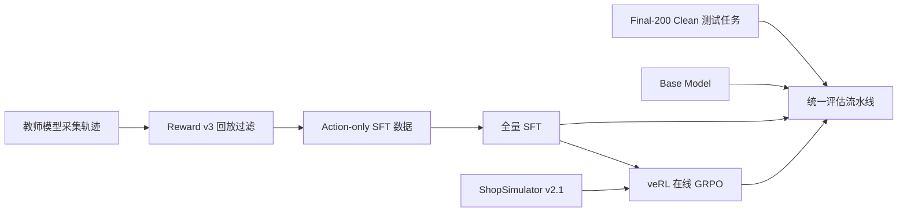
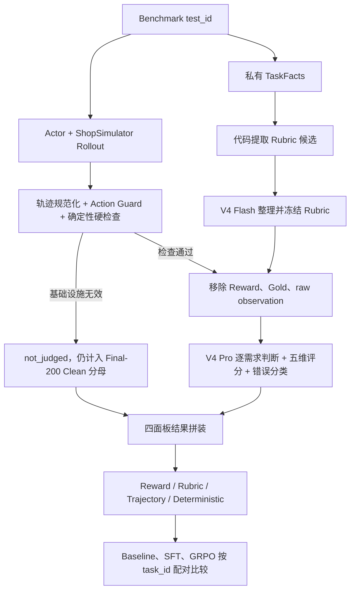

# Shopping GRPO

<div align="center">

**简体中文** · [English](README.en.md)

<br />

面向长程购物 Agent 的可复现后训练与评测项目

<br />

[](pyproject.toml)
[](docs/sft.md)
[](https://github.com/verl-project/verl)
[](https://arxiv.org/pdf/2601.18225)
[](docs/evaluation-dataset.md)

<br />

教师轨迹与全量 SFT → veRL 在线 GRPO → Final-200 Clean Benchmark 的可审计对比

</div>


## ShopSimulator 是什么？

[ShopSimulator](https://arxiv.org/pdf/2601.18225) 是一个用于评估长程购物
Agent 的大规模中文购物环境。每个任务会给出一段用户需求，其中可能包含商品类别、
预算、品牌、型号、核心功能以及颜色、尺寸、容量、套餐等具体规格。

Agent 不能只生成一句“推荐购买某商品”，而是必须真正与环境交互：

1. 根据需求搜索商品；
2. 打开并比较候选商品；
3. 查看描述、参数和可选规格；
4. 选择正确的商品变体；
5. 购买满足约束的商品，或者在证据充分时合理终止。

这类任务同时考察指令理解、工具调用、长上下文管理、约束满足和终止决策。项目内嵌
了冻结的 ShopSimulator Environment v2.1 源码和商品数据，位于
[`environments/ShopSimulator/`](environments/ShopSimulator/)，不需要用户再单独
克隆或修改一份环境仓库。


## 项目做了什么？

项目按照一条连续的后训练流水线组织：



| 阶段 | 目标 | 入口 | 详细文档 |
|---|---|---|---|
| Baseline | 测量所选基模的工具使用能力 | `bash scripts/baseline.sh` | [评估](docs/evaluation.md) |
| SFT | 从高质量教师轨迹学习合法、完整的购物行为 | `bash scripts/sft.sh` | [SFT](docs/sft.md) |
| GRPO | 在真实环境 Rollout 中优化 Reward v3 | `bash scripts/grpo.sh` | [GRPO](docs/grpo.md) |
| Evaluation | 使用同一批 Final-200 Clean 留出任务公平比较模型 | `bash scripts/evaluate.sh NAME` | [评估](docs/evaluation.md) |

### SFT 数据是怎么收集的？

当前数据使用 `deepseek-v4-flash` 作为教师模型，在 ShopSimulator
Environment v2.1 中采集：

- 共获得 2,498 条原始任务轨迹；
- 每条轨迹在采集时都真实执行环境动作，再按 Reward v3 终局结果验收；
- 其中 1,026 条通过严格验收，本次固定使用 1,000 条；
- 最终划分为 800 条训练数据和 200 条验证数据，并与 GRPO、Final-200 Clean
  保持 task_id 零重叠。

重新采集使用两个独立脚本。先启动 ShopSimulator，并导出教师接口的
`OPENAI_BASE_URL`、`OPENAI_API_KEY` 和 `OPENAI_MODEL`，再执行：

```bash
python scripts/collect_sft_data.py \
  --task-range 0 5000 --limit 3000 \
  --output-dir outputs/sft-collection/raw \
  --workers 4

python scripts/clean_sft_data.py \
  --raw outputs/sft-collection/raw/raw.jsonl \
  --output-dir outputs/sft-collection/clean \
  --validation-ratio 0.2 --seed 42
```

第一步保留全部成功/失败轨迹，支持断点续跑；第二步完全离线，验收、清洗、去重并划分。
两步均排除评测集及当前 GRPO 任务池，详细参数和日志命令见[数据采集文档](docs/data-collection.md)。

SFT 只在 Assistant 回合（含工具调用和保留的文字）上计算 Loss，用户指令和环境 Observation 会被
Mask。这样模型学习的是可执行的工具策略，而不是背诵环境返回内容。数据哈希、接受率
和采集审计见[数据采集文档](docs/data-collection.md)。

### GRPO 是怎么训练的？

GRPO 默认从完整导出的 Qwen3.5-9B SFT 模型开始。veRL 在 ShopSimulator 中为每个 Prompt 在线生成
四条轨迹，环境用确定性的 Reward v3 评估最终购买结果、约束满足程度和终止行为。
训练不使用额外的 LLM-as-a-Judge Reward Model。

GRPO 入口选择当前服务器的 veRL `0.9.0.dev` 源码
（接受等价的 `0.9.0.dev0` 及本地构建后缀），保留项目自己的 AgentLoop、工具适配层、
运行时 hooks 和动态采样校验。不会安装其他 veRL 版本来替换服务器环境。
动态采样直接集成在基于服务器源码修改的
[`integrations/verl/ray_trainer.py`](integrations/verl/ray_trainer.py) 中，
通过安装脚本备份并替换所选 veRL 中的同名文件；原 0.8 补丁及 marker 检查已移除。
预检查校验实际部署文件的内容哈希，完整 NPU 训练仍需服务器验证。
默认单机 8 张 NPU、FSDP Actor、Rollout TP=2，
GRPO 继续使用原有 LoRA 配方。详细配置见
[GRPO 文档](docs/grpo.md)。

### 评估流水线是怎么设计的？

正式评估由“代码硬检查 + 两个 LLM-as-Judge + 固定分母聚合”组成。两个 Judge
职责不同：

- **DeepSeek V4 Flash 是 Rubric Curator。** 代码先根据每道题的 Query 和私有
  TaskFacts 提取品类、品牌、型号、功能、规格和价格候选；Flash 只能从候选中选择
  用户真正要求的约束、去重并标注 hard/soft，不能创造新的字段或期望值。生成的
  Rubric 冻结一次，由 Baseline、SFT 和 GRPO 共用。
- **DeepSeek V4 Pro 是 Trajectory Judge。** 它读取用户 Query、冻结 Rubric、
  Actor 实际看到的完整轨迹、中性终局状态和白名单代码指标，逐条判断需求是否满足，
  并从搜索策略、候选利用、证据核验、决策质量、终止效率五个维度分别打 0/1/2 分。

这里的 Rubric 是逐任务评分标准，不是向量检索式 RAG。



以 Final-200 中的 `task_id=8187` 为例，Query 要求“一对卡通-永结同心款的高档
酒红色木梳、礼盒、陪嫁、20 元左右”。代码生成 7 条候选，V4 Flash 冻结为 5 条
Rubric；SFT Actor 用 10 步完成搜索、详情核验、规格选择和购买；V4 Pro 最终给出
`搜索策略 2 / 候选利用 1 / 证据核验 1 / 决策质量 2 / 终止效率 2`，并为每项判断
引用真实的 `event_id`。

Pro 看不到 Reward 分数、Gold 商品私有字段、raw Observation、成功标签或其他模型
结果，因此不能根据答案倒推轨迹质量。最终结果分为四个独立面板：

1. Environment Reward 与终局；
2. Query Rubric 的 hard/soft 满足情况和 Reward disagreement；
3. Pro Judge 五维分布与错误类型；
4. 步数、工具、Guard、重复、上下文和基础设施指标。

四部分不会合成一个总分。缺失、报错和 `not_judged` 任务仍保留在 Final-200 Clean 分母中。
完整数据流、两个模型的完整 Prompt、输入隔离规则、示例 Rubric 和最终统计口径见
[评估流水线文档](docs/evaluation.md)。当前集的筛选依据见
[Final-200 Clean 说明](docs/evaluation-dataset.md)；[Final-200 Dashboard（历史）](docs/evaluation-dashboard.html)
只保留为历史归档。


## 实验结果

当前 Final-200 Clean 上新增了一次贡献者复现实验；完整协议、失败分布和产物哈希见
[评测更新记录](docs/evaluation-updates.md)：

| 模型 | 严格成功率 | 购买成功率 | 完成终局率 | 平均 Reward |
|---|---:|---:|---:|---:|
| Qwen3.8-27B（BF16 权重，关闭思考） | 73.0% | 73.0% | 99.5% | 0.6354 |

以下是历史 Final-200 的归档结果；当前横向比较统一使用 Final-200 Clean：

| 模型 | 严格成功率 | 购买成功率 | 平均 Reward |
|---|---:|---:|---:|
| Qwen3.5-2B Baseline | 0.0% | 0.0% | -0.1105 |
| LoRA SFT | 60.5% | 60.5% | 0.4729 |
| GRPO step 100 | 62.0% | 62.5% | 0.5158 |

SFT 带来了主要能力提升，让模型学会合法工具调用、长程搜索和正确终止；GRPO 在此
基础上进一步减少错误购买、循环和非法动作。机器可读的训练配置、结果摘要和限制说明
位于 [`experiments/`](experiments/)。

## 训练硬件与耗时

以下已有实验的训练耗时来自单张 NVIDIA RTX 6000（96 GB），不代表当前 9B、
单机 8 张 NPU 默认配置的耗时或效果；新配置仍需在目标服务器上验证。

### SFT LoRA 训练（448 条训练数据，3 个 epoch）

| 阶段 | 耗时 | 峰值显存 |
|---|---:|---:|
| 单个 epoch（56 步） | ~62 分钟 | 89 GiB |
| 完整 3 个 epoch | ~3 小时 | 89 GiB |

### 既有 GRPO 耗时记录（veRL 0.8，8 个环境 worker）

以下是原有环境记录，不是当前 veRL 0.9.0.dev/NPU 配置的实测结果。

| 步数范围 | 单步耗时 | 累计耗时 |
|---|---:|---:|
| step 0–24 | ~140 秒/步（含 Ray 启动开销） | ~56 分钟 |
| step 20–30 稳定后 | ~73–120 秒/步 | ~2 分钟/步稳定态 |
| 100 步（报告 checkpoint） | ~110 秒/步均值 | ~3–4 小时 |
| 完整 500 步 | ~100 秒/步 | ~14 小时 |

### 其他环节

| 环节 | 耗时估算 |
|---|---:|
| Teacher 采集（2,498 条原始轨迹） | 取决于接口并发与限流 |
| 200 任务评测（Base） | ~20 分钟 |
| 200 任务评测（SFT/GRPO） | ~40–60 分钟 |
| LLM Judge 评分 200 条轨迹 | ~30–60 分钟 |

## 环境要求

- Linux；
- 已配置兼容的 PyTorch、Transformers、veRL 和 vLLM；当前 GRPO 默认使用 8 张 Ascend NPU，需要 torch_npu、vllm-ascend 和 HCCL；
- 安装独立 ShopSimulator 时需要 [`uv`](https://docs.astral.sh/uv/)；
- 为 9B 模型、checkpoint、优化器状态、商品数据和日志预留足够磁盘空间；
- 历史 LoRA SFT 配方以 48 GB 显存为设计目标；当前默认 9B 全量 SFT 使用 8 卡 ZeRO-3，容量需实测；
- GRPO 默认使用 FSDP 分片 Actor、Rollout TP=2、BF16；实际峰值显存和性能需实测。

已有服务器环境使用 Python 3.10 或更新版本，通过 `--check-only` 检查实际依赖、
设备和集成接口，不强制换成 Python 3.12 或 CUDA 固定版本。独立 ShopSimulator
使用 Python 3.10。`scripts/setup.sh` 的全新安装配方使用固定训练依赖和 Python 3.12，
不应覆盖已有可用的 Ascend 训练环境。

## 快速开始

以下命令都在仓库根目录执行。

### 1. 安装

```bash
bash scripts/setup.sh
```

该脚本会安装固定版本的 SFT 和 vLLM 等依赖，创建独立的 ShopSimulator
环境，校验并解压商品数据，构建搜索索引。veRL 使用服务器已有的 0.9.0.dev
源码；setup 不安装 veRL，也不修改其训练循环。

如果已有可用的训练环境（例如已配置好的 Ascend NPU / veRL 环境），只安装
ShopSimulator：

```bash
bash scripts/setup.sh --shopsim-only
```

这个模式只安装独立的 Python 3.10 环境中的 ShopSimulator 依赖，并准备商品数据和
搜索索引；不会执行主环境的 `uv sync`，也不会安装训练依赖或修改已有 veRL。
脚本会复用已有的 `uv`；找不到时通过 `curl` 或 `wget` 自动安装到
`~/.local/bin`（可用 `UV_INSTALL_DIR` 修改），无需手动设置 PATH，也不会修改 shell
配置文件。可用 `SHOPSIM_PYTHON=/path/to/python3.10` 指定现有解释器。
ShopSimulator 服务使用 CPU，无需加载模型或占用 NPU。

### 2. 启动 ShopSimulator

在第一个终端运行并保持服务：

```bash
bash scripts/start_environment.sh
```

服务默认监听 `http://127.0.0.1:5700`。
启动输出和服务控制台日志追加到 `outputs/shopsimulator/server.log`。
可通过 `SHOPSIM_PORT`、`SHOPSIM_ENV_SLOTS` 调整端口和环境槽位数；槽位数与 NPU
数量无关。服务以前台方式运行，按 `Ctrl+C` 停止。

### 3. 运行 Baseline

在第二个终端启动已下载的基础模型：

```bash
bash scripts/serve_model.sh Qwen/Qwen3.5-2B
```

模型默认从仓库同级的 `models` 目录查找：`Qwen3.5-4B` 和 `Qwen/Qwen3.5-4B` 都映射到 `../models/Qwen3.5-4B`（相对于仓库）。可设置 `export MODEL_ROOT=/path/to/models` 更换根目录，或直接传入已有模型目录。找不到本地目录会报错，不会自动下载模型；启动时会打印实际模型路径。

已配置独立的 vLLM / Ascend 环境时，先激活该环境再执行。脚本优先使用当前 `PATH` 中的 vLLM（或安装了 vLLM 的 Python），找不到时才使用仓库的 `.venv/bin/vllm`；也可通过 `PYTHON_BIN` 明确指定解释器，无需重新安装训练环境：

```bash
PYTHON_BIN="$(command -v python)" bash scripts/serve_model.sh Qwen/Qwen3.5-4B --enforce-eager
```

模型名称之后的参数会原样传给 `vllm serve`，例如 `--tensor-parallel-size 4`。`--enforce-eager` 可用于关闭图捕获；具体并行度应根据模型和设备设置。使用 `python -m pip show vllm` 检查当前 Python 的安装情况；单独的 `pip show vllm` 可能对应另一个环境。脚本会打印实际使用的启动程序，启动后的导入或设备错误会保留原始报错。

在第三个终端评估：

```bash
bash scripts/baseline.sh
```

`baseline.sh`、`evaluate.sh`、`report.sh` 和 `report_all.sh` 使用同一解释器选择规则：显式 `PYTHON_BIN` → 当前 `PATH` 中的 `python` / `python3` → 仓库 `.venv/bin/python`。脚本将当前仓库的 `src` 加入 `PYTHONPATH`，因此仅安装 ShopSimulator 时也能导入评测代码，无需安装训练依赖。评测和报告生成使用同一个 Python（要求 3.10 或更新版本）：

```bash
PYTHON_BIN="$(command -v python)" bash scripts/baseline.sh
```

评测默认每 15 秒显示当前任务、已记录数量、环境步骤、所处阶段、累计耗时和预计剩余时间（ETA）。ETA 按本次新完成任务的平均耗时估算；续跑时会单独显示已有记录，首条新任务完成前暂不估时。“已记录”包括失败任务，不代表严格成功数。

每个任务默认每 5 个环境步骤打印一段新增的真实 rollout：包括模型消息、工具调用参数、环境返回、模型可见 observation、奖励和动作拒绝记录。任务结束会补齐剩余轨迹和终止状态；没有执行环境步骤的最终回复或错误也会打印。日志直接取自采集记录，不额外请求模型、不截断 observation，也不改变 `trajectories.jsonl` 格式。可调整间隔并保存控制台日志：

```bash
mkdir -p outputs/evaluation/baseline
EVAL_ROLLOUT_PRINT_EVERY=5 EVAL_PROGRESS_INTERVAL=15 \
  bash scripts/baseline.sh 2>&1 | tee -a outputs/evaluation/baseline/console.log
```

`EVAL_ROLLOUT_PRINT_EVERY=1` 会逐步打印，设为 `0` 则只显示进度；`EVAL_PROGRESS_INTERVAL=0` 仅在任务开始/结束时显示进度。直接调用 Python 入口时对应 `--rollout-print-every` 和 `--progress-interval`。两类日志都写入 stderr 并立即刷新。更新代码只影响新启动的评测进程；正在运行的进程不会自动加载新日志逻辑。

开始训练前请停止模型服务，释放 GPU 显存。

### 4. 全量 SFT 并评估

主入口默认使用仓库已经清洗好的 `data/sft/train.jsonl`（800 条）和
`data/sft/validation.jsonl`（200 条），无须重新采样。
使用当前 Python 环境，通过 Transformers Trainer + DeepSpeed 更新完整模型参数；
无需 LoRA adapter 或合并步骤。基模默认是仓库旁 `models/Qwen3.5-9B`，可用
`BASE_MODEL` 指定实际模型目录，`PYTHON_BIN` 可指定已配置的 Python。
环境需要兼容的 DeepSpeed；veRL 能运行不代表 DeepSpeed 已配置好，启动脚本不安装环境。

```bash
bash scripts/sft.sh
bash scripts/serve_model.sh outputs/models/sft-full
bash scripts/evaluate.sh sft
```

默认使用单机 8 卡数据并行 + ZeRO-3（DP=8、TP=1），加载
`configs/sft_zero3.json`，启用 BF16、每卡 batch=1 和 gradient checkpointing。
有效全局 batch 为 `每卡 1 × 8 卡 × 累积 8 = 64`，最大长度保持 24,576。
ZeRO-3 分片参数、梯度与优化器状态；关闭通信重叠和预取、减小通信桶并限制参数缓存，
以降低峰值显存，可能增加通信等待。不量化、不开启 offload 或默认 Liger；这些设置
不是显存硬上限，仍可能遇到长序列激活或 logits 的峰值。
`--deepspeed 配置.json` 可覆盖默认配置，`configs/sft_zero2.json` 保留为显式选项。
分片本身不降低数值精度，但浮点归约等差异意味着不能保证最终成绩完全相同。
详见 [SFT 指南](docs/sft.md)。已有 LoRA 评测分数不代表新全量方案效果。

切换 ZeRO-2 → ZeRO-3 不应直接恢复旧 ZeRO-2 优化器 checkpoint。
从基模重新开始时，可使用 `SFT_OUTPUT_DIR=outputs/models/sft-full-zero3` 保留旧产物；
从完整导出的模型继续训练则用 `BASE_MODEL` 指定，它会重新建立优化器，不等价于断点恢复。

如果要使用[重新采样清洗](docs/data-collection.md)后的数据，显式设置：

```bash
SFT_TRAIN_FILE=outputs/sft-collection/clean/train.jsonl \
SFT_VALIDATION_FILE=outputs/sft-collection/clean/validation.jsonl \
  bash scripts/sft.sh
```

SFT 默认从 9B 基模训练，GRPO 默认接续它的完整 SFT 输出；`serve_model.sh` 未传位置参数时仍选择 2B。
比较 9B 的训练收益时，baseline 阶段应先用 `bash scripts/serve_model.sh Qwen3.5-9B`
服务同一基模，再运行 `bash scripts/baseline.sh`。评测请求的 `SERVED_MODEL_NAME`
须与服务一致，默认均为 `shopping-agent`。
完成评估后再次停止模型服务。

### 5. 训练 GRPO

保持 ShopSimulator 运行，停止自己的 Baseline/SFT `vllm serve` 以释放 NPU。
GRPO 会创建内部 vLLM Rollout worker，不需要单独启动模型服务。
先激活服务器已有的 veRL 环境；脚本按 `PYTHON_BIN` → 当前 Python → 仓库 `.venv`
的顺序选择解释器。若需要指定 veRL 源码，设置 `VERL_ROOT=/path/to/verl-checkout`，
指向包含 `verl/__init__.py` 的仓库目录。

在服务器上安装已集成动态采样的训练器（仅首次安装或训练器文件更新后需要）：

```bash
export PYTHON_BIN="$(command -v python)"
PYTHONPATH="${VERL_ROOT:+$VERL_ROOT:}${PYTHONPATH:-}" \
  "$PYTHON_BIN" scripts/install_verl_trainer.py
```

脚本只替换实际导入的 `verl/trainer/ppo/ray_trainer.py`，自动备份已核对的服务器原版，
拒绝覆盖其他未知修改。不会安装 veRL 或应用旧版本补丁。

先打印最终命令，再进行不加载权重、不启动 Ray 或训练的预检查：

```bash
bash scripts/grpo.sh --dry-run
bash scripts/grpo.sh --check-only
```

默认模型是 `outputs/models/sft-full`，可用 `--model` 或 `GRPO_MODEL_PATH` 指向
其他完整 9B SFT 输出；找不到时不会自动退回基模。预检查通过后开始训练：

```bash
bash scripts/grpo.sh
```

默认单机 8 张 NPU：Actor 使用 FSDP 分片，Rollout TP=2（4 组副本），
启用 BF16 和 eager 模式。保留原有每批 2 个 Prompt、每个 Prompt 4 条轨迹、
LoRA rank=16/alpha=32、学习率 `1e-6`、最大长度 24,576 和 500 个训练 step。
全局一次有效更新对应 8 条轨迹，不再乘以卡数。这里的 FSDP/LoRA 与 SFT 的
DeepSpeed ZeRO-3 全量微调分别配置。单机 veRL 仍需要 Ray，但不会等待第二个节点。
动态采样要求每批生成新轨迹，`skip.rollout.enable` 和
`actor_rollout_ref.rollout.skip.enable`（若所选 veRL 配置中存在）必须关闭，
避免同一个 optimizer step 内重放缓存轨迹。其余训练参数保持上述设置。

项目的动态采样训练器仍必须通过内容哈希校验。若服务器分支源码哈希不匹配，先按
[GRPO 指南](docs/grpo.md)核对实际文件，不要强制覆盖未知修改或静默关闭动态采样。
控制台日志写入 `outputs/models/grpo/train.log`，同时保留 `launch.json` 和
`training_diagnostics.jsonl`。输出目录必须新建或为空；保留旧产物时使用
`--output outputs/models/grpo-9b`，后续导出路径也相应修改。

每个动态采样 checkpoint 除 actor 状态外，还保存 `data.pt` 和
`shopping_sampler_state.json`。后者记录真实 epoch、该 epoch 已消费的 batch 游标
及采样器状态，与 dataloader 状态配合断点恢复；不能根据 optimizer step 推算数据位置。
旧 checkpoint 缺少这些状态时会明确报错，不猜测恢复。续训需指定完整 checkpoint
和新输出目录，命令见 [GRPO 日志与断点恢复](docs/grpo.md#logs-and-checkpoints)。

根据验证集指标选择 Checkpoint，并导出 veRL Actor：

```bash
bash scripts/export_grpo.sh \
  outputs/models/grpo/global_step_100/actor \
  outputs/models/grpo-merged
```

启动并评估导出的模型：

```bash
bash scripts/serve_model.sh outputs/models/grpo-merged
bash scripts/evaluate.sh grpo
```

每次 `evaluate.sh` 完成后会自动生成 `outputs/evaluation/grpo/report.html`。对已有评测结果补生成报告：

```bash
bash scripts/report.sh grpo
```

批量生成所有单模型报告和综合比较报告：

```bash
bash scripts/report_all.sh
```

报告生成器按评测目录读取 `summary.json` 和 `trajectories.jsonl`，模型名与评测参数会从结果中自动填入，因此换模型或换评测标签不需要修改报告代码。

Checkpoint、Rollout 和日志统一写入 Git 忽略的 `outputs/`。

## Reward v3 简介

Reward v3 是一个确定性的终局 Reward，不依赖另一个大模型进行主观判断：

- 类别和预算是 Hard Gate；
- 品牌、型号、核心功能、关键规格按照 `0.35 / 0.25 / 0.25 / 0.15` 加权；
- 完全满足并命中目标商品得到 `1.0`；
- 完全满足的替代商品得到 `0.55`；
- 部分满足按照连续分数计算，最高 `0.25`；
- 错误购买、过早放弃、重复循环和达到最大步数都会获得不同负奖励；
- 证据不足时标记为 `reward_valid=false`，不会伪装成有效的零分样本。


完整公式、终止条件和证据要求见 [Reward v3 设计文档](docs/reward-v3.md)。

## 仓库结构

```text
configs/                         当前 GRPO、AgentLoop 和工具配置
data/
  sft/                           800 条训练 + 200 条验证轨迹
  grpo/                          JSONL 与 veRL Parquet 数据
  evaluation/                    Final-200 Clean 留出任务
docs/                            数据、SFT、GRPO、评估与 Reward 文档
environments/ShopSimulator/      内嵌环境源码和商品数据
experiments/
  baseline/                      Baseline 配置与结果
  sft/                           SFT 配置与结果
  grpo/                          GRPO 配置与结果
scripts/                         面向用户的薄入口脚本
src/shopping_grpo/
  collection/                    Teacher 轨迹验收与 SFT 数据构造
  environment/                   环境客户端、动作、工具和 Observation
  training/sft/                  SFT 数据渲染与 Mask
  training/grpo/                 veRL AgentLoop、适配和动态采样
  evaluation/                    硬检查、Rubric、轨迹 Judge 和指标汇总
tests/                           核心单元、入口和 Wheel 安装检查
```

## 常用配置

| 环境变量 | 默认值 |
|---|---|
| `BASE_MODEL` | SFT：`../models/Qwen3.5-9B` |
| `SHOPSIM_BASE_URL` | `http://127.0.0.1:5700` |
| `LLM_BASE_URL` | `http://127.0.0.1:8000/v1` |
| `SERVED_MODEL_NAME` | `shopping-agent` |
| `SFT_TRAIN_FILE` | `data/sft/train.jsonl` |
| `SFT_VALIDATION_FILE` | `data/sft/validation.jsonl` |
| `SFT_OUTPUT_DIR` | `outputs/models/sft-full` |
| `SFT_NPROC_PER_NODE` | `8`（单机数据并行 + ZeRO-3，TP=1） |
| `GRPO_MODEL_PATH` | `outputs/models/sft-full`（完整 9B SFT 模型） |
| `VERL_ROOT` | 未设置：使用所选 Python 中安装的 veRL；设置时为源码仓库根目录 |

GRPO 的高级 Hydra 参数可以追加在 `--` 后：

```bash
bash scripts/grpo.sh -- \
  trainer.total_training_steps=20 \
  trainer.save_freq=10
```

SwanLab 默认关闭，需要时显式启用：

```bash
export SWANLAB_API_KEY=...
bash scripts/grpo.sh --logger swanlab
```

## 文档导航

- [数据采集与数据来源](docs/data-collection.md)
- [SFT：全量微调与可选 LoRA](docs/sft.md)
- [使用 veRL 进行 GRPO](docs/grpo.md)
- [留出集评估](docs/evaluation.md)
- [Final-200 Clean 测试集说明](docs/evaluation-dataset.md)
- [Final-200 Benchmark Dashboard（历史）](docs/evaluation-dashboard.html)
- [Reward v3 设计](docs/reward-v3.md)
- [可审计实验结果](experiments/comparison.md)

## 后续改进计划

为进一步提升模型在长程购物任务中的规划、工具调用与约束满足能力，后续将从以下几个方面推进项目：

- **扩大模型规模**：在现有实验基础上，训练更大规模的 `Qwen3.5-9B` 模型，评估模型规模对长程任务稳定性和最终成功率的影响。
- **升级 Teacher 模型与轨迹采集方案**：不再依赖单一 Teacher 模型，计划采用 `Qwen3.8 Flash`、`GLM-5.3-Flash` 和 `DeepSeek-V4-Flash-0731` 的混合方案进行轨迹收集，以提升训练数据的覆盖范围、行为多样性与质量上限。
- **扩大独立验证集**：增加验证任务数量和任务类型，覆盖更多商品类别、约束组合与交互路径，从而提高实验结论的统计可靠性和泛化评估能力。
- **引入更细粒度的信用分配**：针对长程交互中终局奖励稀疏、动作贡献难以区分的问题，采用更细粒度的信用分配方法，为关键中间步骤提供更有效的训练信号。

## Star History

<a href="https://www.star-history.com/?repos=YYHDBL%2Fshopping-grpo-longhorizon&type=date&legend=top-left">
 <picture>
   <source media="(prefers-color-scheme: dark)" srcset="https://api.star-history.com/chart?repos=YYHDBL/shopping-grpo-longhorizon&type=date&theme=dark&legend=top-left&sealed_token=wgQ1K2TiIB2luvZFJ54oMEhME-cxYmFv_wNoNXnT7lMZHsuQUy7NThQAG2VwpEeiUBoRxd09ASiB60cvvBaEvqVqyv49wYKZSF2H_Jft3Iq1ZZ0c5Sk2SQQejxHxMQwayMTRroOh5JhcWgXk6w8HHwjP6UgTquINRr40c7XysMi_j2BksVwqOWSIz8Ny" />
   <source media="(prefers-color-scheme: light)" srcset="https://api.star-history.com/chart?repos=YYHDBL/shopping-grpo-longhorizon&type=date&legend=top-left&sealed_token=wgQ1K2TiIB2luvZFJ54oMEhME-cxYmFv_wNoNXnT7lMZHsuQUy7NThQAG2VwpEeiUBoRxd09ASiB60cvvBaEvqVqyv49wYKZSF2H_Jft3Iq1ZZ0c5Sk2SQQejxHxMQwayMTRroOh5JhcWgXk6w8HHwjP6UgTquINRr40c7XysMi_j2BksVwqOWSIz8Ny" />
   
 </picture>
</a>

## 引用与致谢

本项目建立在
[ShopSimulator 论文](https://arxiv.org/pdf/2601.18225)及其开源环境、
[veRL](https://github.com/verl-project/verl) 和
[Qwen](https://github.com/QwenLM/Qwen3) 之上。

评测协议和 Benchmark 构建还参考了
[VitaBench: Benchmarking LLM Agents with Versatile Interactive Tasks in Real-world Applications](https://arxiv.org/pdf/2509.26490)
以及
[EComAgentBench: Benchmarking Shopping Agents on Long-Horizon Tasks with Distributed Hidden Intent](https://arxiv.org/pdf/2606.17698)。

仓库结构和教程呈现参考了
[qiqihezh/agentic-grpo-longhorizon](https://github.com/qiqihezh/agentic-grpo-longhorizon)。
感谢 [OpenCode Go 套餐](https://dev.opencode.ai/go) 对开发工作的支持。

### Contributors

<a href="https://github.com/Guochangwei917">
  
</a>
