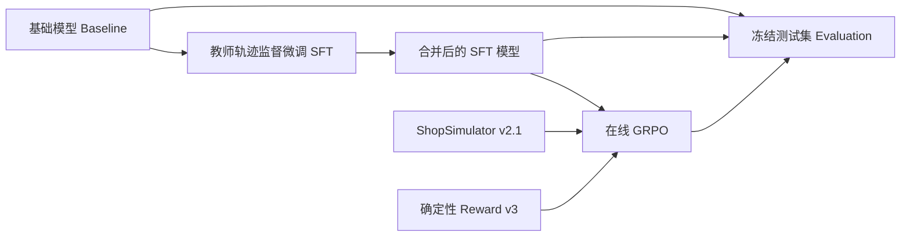

# Shopping GRPO 项目研究与评测说明

本项目面向中文电商中的多步购物代理：模型接到完整购物需求后，需要搜索商品、检查详情、选择规格，并通过工具真正完成模拟购买。核心研究问题是：一个小模型能否先通过监督微调学会工具操作，再通过在线强化学习提高约束满足率和决策质量。

**现有证据支持的主要结论是：SFT 带来了主要能力提升，GRPO 在历史实验上取得了较小的进一步改善，但当前课程训练方案在新版正式测试集上的端到端收益尚缺少完整、可核验的对照结果。** 历史 Qwen3.5-2B 的严格成功率为 Baseline 0%、SFT 60.5%、GRPO step 100 62.0%；这三项属于旧版 Final-200，不能作为当前 Final-200 Clean 的成绩。当前 Clean 集另有一项 Qwen3.8-27B 贡献者评测记录，严格成功率为 73.0%，它也不是本项目小模型后训练流水线的最终成绩。

研究对象为仓库提交 `449bba2`，核对日期为 2026 年 10 月 15 日。以下内容依据源码、实际数据、配置及已提交实验摘要，并辅以离线统计和轻量测试。本次没有启动模型训练、权重合并、模型推理或 200 题在线评测。

## 1 项目适用场景与能力边界

### 1.1 解决什么问题

普通推荐回答只需要生成商品建议；本项目要求模型把建议变成一系列合法操作，并使最终选购结果满足用户约束。需求可能同时包含商品类型、品牌、型号、功能、预算、颜色、尺寸、容量或组合套餐。

例如，用户要购买特定颜色、数量和包装的木梳，模型必须根据搜索结果打开候选，核验商品说明，选择正确组合，再调用购买工具。只回答“这款很合适”、点开相近商品或选对商品却选错规格，都不能获得严格成功。这类任务适合研究：

- **多步工具调用**：根据当前页面选择下一步合法操作，避免引用旧页面或未出现的商品 ID。
- **约束满足**：把自然语言要求转化为对商品、规格和最终价格的核验。
- **长程决策**：在搜索、比较、核验、购买和放弃之间分配有限步骤。
- **小模型后训练**：比较模仿教师轨迹和环境奖励优化各自带来的收益。
- **评测可信度**：区分购买成功、目标商品命中、过程质量和基础设施错误。

“长程”在这里指多轮模型与环境交互，而非多轮用户需求澄清。当前 system prompt 规定完整需求在开头给出，不向用户追问。最多 35 个环境步骤也不意味着每个任务都需要 35 步；历史 SFT/GRPO 平均约 12 步。

### 1.2 模型面对的环境

仓库内嵌 ShopSimulator Environment v2.1 源码与冻结商品数据。对压缩数据的离线统计得到：23,421 个商品、23,421 个唯一 ASIN、235 个完整类目路径，覆盖家居家装、服饰鞋包饰品、休闲娱乐文教、美妆个护健康、生产材料农用品、家用电器数码、运动户外交通、食品饮品和母婴儿童九个大域。

底层搜索使用多字段 BM25，检索上限 150 项，每页 20 项；商品标题、型号、品牌等字段使用不同权重。Actor 接收结构化文本和可操作元素，而不是网页截图。搜索和观察投影本身会影响模型能看到哪些证据，因此最终成绩反映的是模型、提示词、工具、搜索、观察投影和动作守卫共同组成的系统。

这一环境适合做受控实验，但现有成绩不证明真实电商网站上的视觉理解、登录、支付、库存变化、物流、售后或多商品订单能力，也不证明对开放网站结构变化的适应能力。任务目标是模拟环境中的单次商品购买终局。

依据：[项目介绍](../README.md)、[环境契约](../data/environment.json)、[商品数据](../environments/ShopSimulator/shop_env/data/fine_items_eval_train_all.json.gz)、[Actor 提示与 Rollout](../src/shopping_grpo/evaluation/rollout.py)。

## 2 系统架构与运行契约

仓库只支持一条主工作流：



| 层次 | 主要职责 | 实现位置 |
|---|---|---|
| 模拟环境 | 商品、搜索、页面状态、规格、购买和终止 | `environments/ShopSimulator/shop_env/` |
| 环境适配 | HTTP 客户端、工具到动作转换、合法性检查、观察投影 | `src/shopping_grpo/environment/` |
| 数据采集 | 调用教师、保存轨迹、验收与训练消息清理 | `src/shopping_grpo/collection/`、`scripts/collect_sft_data.py` |
| SFT | 模板渲染、监督标签、LoRA 训练与课程编排 | `training/sft/`、`scripts/train_sft.py` |
| GRPO | veRL AgentLoop、在线交互、奖励校验、动态采样、可选 TRACE | `training/grpo/`、`configs/grpo.yaml` |
| 评测 | 轨迹规范化、严格成功、Rubric、Judge 隔离、统计和报告 | `src/shopping_grpo/evaluation/` |

运行契约固定为 Environment v2.1、Reward v3、observation v2、tool schema v2。模型每次应产生一个工具调用，适配层把工具映射为环境的 `search[...]`、`click[...]` 或 `finish[...]` 动作。

主要工具包括 `search_products`、`open_product`、`view_description`、`view_features`、`view_reviews`、`select_option`、页面导航、`buy_now` 和 `finish_without_purchase`。动作守卫依据当前可见商品、按钮和选项拦截非法调用；因此“模型尝试过某动作”和“环境实际执行过某动作”是两个不同指标。

观察预算也属于实验条件：搜索页默认 1,536 token、详情页 4,096 token、通用回退 768 token，搜索观察最多保留 20 个候选。投影尽量保留关键操作信息，不能把完整底层商品库直接暴露给 Actor。评测默认上下文窗口 24,576 token，不压缩历史，另留 512 token 安全余量。

依据：[工具定义](../src/shopping_grpo/environment/tools.py)、[动作检查](../src/shopping_grpo/environment/actions.py)、[观察投影](../src/shopping_grpo/environment/projection.py)、[上下文管理](../src/shopping_grpo/environment/context.py)、[评测入口参数](../scripts/evaluate_shop_benchmark.py)。

## 3 训练数据如何得到

### 3.1 教师轨迹采集与验收

教师模型在环境中逐步执行购物动作，采集器记录用户需求、Assistant 输出、工具调用、观察、守卫拒绝和终局信息。当前 `data/sft/metadata.json` 记载的教师为 `deepseek-v4-flash`：2,498 条原始轨迹中，1,026 条被接受，接受率约 41.07%；选用其中 1,000 条，形成 800 条训练和 200 条验证数据。

验收要求包括完整终局、实际购买动作、Reward v3、`gold_purchase`、`reward_valid=true`、`purchase_success=true`、正确终止原因，以及工具动作满足验收条件。终局分数高并不足以单独证明轨迹可以训练。元数据中虽然有 1,742 条 `gold_purchase`，最终仍有 716 条因 guard violation 被排除，剩余 1,026 条。

生成 SFT 消息时会清除私有推理字段、审计字段和终局 Reward 文本，按任务去重、排除留出任务，并按任务划分训练与验证。这里应区分“原始采集时实际执行了环境动作”与“读取已脱敏 JSONL 后再次证明原始成功”：后者不能仅凭末尾存在 `buy_now` 完成。Pure V4 的合并质量标记也不能代替原始终局证据。

### 3.2 当前存在三种不同的数据口径

| 用途或证据 | SFT 数据量 | 含义 |
|---|---:|---|
| 历史 2B 实验的 run config | 379 train / 49 validation | 对应已提交 60.5% SFT 成绩的训练记录 |
| 当前 `data/sft/` 与普通 `sft.sh` | 800 / 200 | 当前文件内容；与历史记录的行数、SHA 不同 |
| 当前 SFT 指南主推的 Pure V4 curriculum | 1,192 总行；1,073 train / 119 development | 当前课程方案；不能继承历史 60.5% 成绩 |

Pure V4 文件有 1,192 行、1,192 个唯一 task ID。元数据记载合并时移除了 258 条同任务重复记录；难度标签为 simple 284、medium 798、hard 110。难度标签是教师标注，用于课程组织，不是独立测得的真实任务难度。

**训练数据行数还不等于实际进入梯度计算的样本数。** Tokenizer 渲染后超长、模板异常或 Assistant 边界不一致的样本会被丢弃。复现时应保存 `total / matched / kept / dropped`，不能只引用 manifest 的 1,073 行。

依据：[采集实现](../src/shopping_grpo/collection/sft.py)、[SFT 元数据](../data/sft/metadata.json)、[Pure V4 元数据](../data/sft_pure_v4/metadata.json)、[历史 SFT 训练记录](../experiments/sft/run_config.json)、[SFT 数据渲染](../src/shopping_grpo/training/sft/dataset.py)。

### 3.3 数据隔离核对

对当前提交数据进行离线核对，SFT 800/200、Pure V4 1,192、GRPO 1,000/50 与正式测试集 200 题，在 **task ID、目标商品 ASIN、完全相同 Query** 三个层面均无交集。GRPO Parquet 已直接读取，其任务 ID 与同目录 JSONL 完全一致；两个 Parquet 的 SHA-256 与元数据一致。

不过，Pure V4 与 GRPO 训练池有 6 个相同任务：

| task ID | 课程划分 | 课程桶 |
|---:|---|---|
| 8993 | train | foundation |
| 11298、12380 | train | constraints |
| 17219 | train | strategy |
| 7682 | development | constraints |
| 14953 | development | strategy |

这不构成 Final-200 Clean 泄漏，但意味着当前课程 SFT 与 GRPO 不是完全互斥的任务池。如果在 GRPO 后继续用这 119 题开发集评价模型，其中 2 题已参与 GRPO 训练。普通 `data/sft/` 的 800/200 与 GRPO 则仍然互斥。

零任务交集也不等于商品从未出现。按工具观察中的搜索结果 ASIN 列和详情页 `asin:` 字段精确提取，而非按数字子串匹配，得到以下曝光统计：

| 数据集合 | 展示过测试目标商品的轨迹数 | 出现过的测试目标商品数 | 展示过详情的测试目标商品数 |
|---|---:|---:|---:|
| SFT train 800 | 132 | 92/200 | 0 |
| SFT validation 200 | 24 | 28/200 | 0 |
| Pure V4 全部 1,192，含 train 与 development | 178 | 117/200 | 1 |

这是共享目录中的候选曝光，不是把相同测试任务的 Query 或 gold 标签拿来训练。现有隔离支持“固定目录上的留出购物任务泛化”，不能直接支持“从未见过该商品”的冷启动泛化结论；近似 Query、近似型号与同系列商品的语义相似性也需要另行度量。

## 4 SFT 如何训练模型

### 4.1 学习目标和监督范围

当前主入口 `scripts/sft.sh` 使用 Transformers Trainer + PyTorch/Accelerate，读取新清洗的训练集/验证集进行全量微调，直接保存到 `outputs/models/sft-full`。可选 LoRA 模式才使用 PEFT；本节保留的 LoRA 配置和已有结果不代表新全量方案的实测效果。一个样本是完整多轮轨迹，包含 system、user、assistant 和 tool 消息，通过目标模型的 chat template 渲染。标签先全部设置为 `-100`，再打开 Assistant 回合对应的 token：

```text
SFT loss = Assistant 受监督 token 的负对数似然
system / user / tool observation 的标签 = -100
```

**当前实现是 Assistant 回合监督，不是严格的 tool-call-only 监督。** Assistant 的自然语言 `content` 和工具调用都会被训练。对 Pure V4 的实际统计为 9,620 个 Assistant 回合，其中 6,099 个同时带有非空自然语言内容；所以 README 中“只训练动作 token”的概括比实现更窄。

这一区别会影响结果解释：自然语言说明较多的来源，即使轨迹行数少，也可能贡献较多监督 token，让小模型学到解释、反复核验或输出结束文本的习惯。工具观察被 mask，只表示不要求模型预测观察文本；它仍然作为上下文供模型学习下一步动作。

### 4.2 全量入口与 LoRA 对照参数

主入口默认全量学习率 `2e-5`，3 个 epoch，读取 `outputs/sft-collection/clean/` 下新数据，使用当前 Python。全量分支不导入 PEFT、不注入 adapter、不调用合并脚本，启动时报告可训练参数数量；其余主要序列/批量设置见 [SFT 指南](sft.md)。以下表格描述显式 `--finetuning-type lora` 的对照配置。

LoRA 将可训练更新限制在低秩适配参数中，避免更新所有基座权重。SFT 目标层不仅包括常见注意力投影和 MLP，还包含 Qwen3.5 Gated DeltaNet 的 `in_proj_qkv`、`in_proj_z`、`in_proj_b`、`in_proj_a`、`out_proj` 等投影，防止只覆盖部分文本层。

| 参数 | 可选 LoRA 配置 |
|---|---:|
| 基座 | `Qwen/Qwen3.5-2B` |
| 最大序列长度 | 24,576 |
| Epoch | 3 |
| 每设备 batch / 梯度累积 | 1 / 8 |
| 单卡名义有效 batch | 8 条轨迹 |
| 学习率 / warmup ratio | `1e-4` / `0.03` |
| LoRA rank / alpha / dropout | 16 / 32 / 0.05 |
| Gradient checkpointing | shell 入口启用 |
| Attention | shell 入口选择 SDPA |
| QLoRA / Liger | 可选，默认不启用 |

超长样本会整条丢弃，而不是强行截断，避免把决定性证据或最终工具调用裁掉。LoRA 模式的产物是 adapter，合并后才能供模型服务或 GRPO 使用；全量模式直接输出完整模型。历史 run config 记载验证 loss 从 0.3365 降至 0.3189、0.3147；这说明模仿目标更容易预测，不能单独证明购物成功率持续上升。

依据：[训练脚本](../scripts/train_sft.py)、[标签构建](../src/shopping_grpo/training/sft/dataset.py)、[普通 SFT 入口](../scripts/sft.sh)。

### 4.3 可选 LoRA 课程方案

`scripts/sft_curriculum.sh` 保留显式 LoRA 的 Pure V4 三阶段课程，主入口不自动选择该方案：

| 阶段 | 累计训练桶 | Train / development | Epoch | 学习率 |
|---|---|---:|---:|---:|
| A | foundation | 256 / 28 | 1 | `1e-4` |
| B | foundation + constraints | 799 / 88 | 1 | `7e-5` |
| C | 全部桶 | 1,073 / 119 | 1 | `5e-5` |

每一阶段训练后先合并；下一阶段从上一阶段的合并模型出发，重新建立 LoRA。课程有可执行脚本和固定任务清单，不只是概念设计。

累计课程也产生了隐含权重：foundation 的 256 个训练任务各出现 3 次，constraints 的 543 个各出现 2 次，strategy 的 274 个只出现 1 次。总计 2,128 次名义行曝光。原始训练集合中 simple/medium/hard 约为 23.9%/66.8%/9.3%，按累计曝光计算变为约 36.1%/59.2%/4.7%。因此它有意强化基础操作，却降低了 hard 任务的相对曝光份额；“课程一定优于一次性训练”目前并无同口径结果证明。

还存在一个入口衔接问题：课程最终模型在 `outputs/models/sft-curriculum/stage-c/merged`，而 GRPO launcher 默认读取 `outputs/models/sft-full`。`train_grpo.py` 会依据 `--model` 覆盖传入环境中的 `GRPO_MODEL_PATH`，仅设置同名环境变量不足以切换起点。使用课程模型时，应显式传 `--model`。

依据：[课程 manifest](../data/sft_curriculum/manifest.json)、[课程权重说明](../data/sft_curriculum/README.md)、[课程编排](../scripts/run_sft_curriculum.py)、[GRPO launcher](../scripts/train_grpo.py)。

## 5 GRPO 如何进一步优化模型

### 5.1 在线交互和组内比较

GRPO 从合并后的 SFT 模型开始，使用固定版本 `verl==0.8.0` 和 vLLM 生成在线轨迹。同一个任务默认生成 4 条 Rollout，每条轨迹都真正调用 ShopSimulator；环境终局 Reward v3 给出数值反馈。训练不启用独立的学习型 Reward Model，也不使用评测用 LLM Judge 的评分作为默认训练奖励。

同题的不同轨迹互相构成比较基线。当前配置 `norm_adv_by_std_in_grpo=false`，因此应按组内奖励减均值理解基本优势，而不是默认套用“再除以组内标准差”的公式：

```text
A_i = R_i - mean(R_1, ..., R_4)
```

例如四条轨迹奖励为 `[1.0, 1.0, 0.25, -0.65]`，组均值为 0.40，基本优势为 `[0.60, 0.60, -0.15, -1.05]`。模型提高相对较好动作序列的概率、压低相对较差序列的概率；“相对较好”由组内比较和奖励定义决定。

PPO 风格 clipping 限制每次更新的变化幅度，损失采用 `token-mean` 聚合。默认终局优势作用于轨迹中的 Assistant response token，工具返回 token 被 mask。这会把一条轨迹中好坏不同的动作一并赋予终局信号，正是长程信用分配的困难所在。

### 5.2 实际配置

| 配置项 | 当前默认值及含义 |
|---|---|
| 训练 / 验证任务 | 1,000 / 50 |
| Prompt batch | 2 |
| 同题 Rollout 数 | 4；一批名义生成 8 条轨迹 |
| Rollout temperature / top-p | 0.7 / 0.9 |
| 验证 Rollout | 每题 1 条，temperature 0 |
| Policy 学习率 | `1e-6` |
| LoRA rank / alpha | 16 / 32 |
| PPO mini batch / micro batch | 2 / 1 |
| Clip lower / upper | 0.20 / 0.20 |
| Loss aggregation | `token-mean` |
| KL reward / KL loss | 均关闭 |
| Entropy | 测量开启；系数为 0，只记录不奖励 |
| Prompt / response token budget | 4,096 / 20,480 |
| 模型上下文长度 | 24,576 |
| 环境步数 / worker | 最多 35 步 / 8 个 |
| 最大训练步数 | 500 |
| 保存 / 验证频率 | 每 50 步 |
| 训练前验证 | 开启 |
| 设备 | 1 节点、1 GPU；参数和优化器可 offload |

这里的 500 步是配置上限，已提交对比成绩来自 step 100，不能称为“最终 step 500 成绩”。历史记录与当前 GRPO 数据文件的哈希也不相同。

依据：[完整 GRPO 配置](../configs/grpo.yaml)、[历史 GRPO run config](../experiments/grpo/run_config.json)、[AgentLoop](../src/shopping_grpo/training/grpo/adapter/agent_loop.py)。

### 5.3 动态采样

当同一任务的 4 条轨迹奖励相同，组内优势为零，无法产生有效的相对学习信号。动态采样会按 prompt 分组，以 `terminal_utility` 判断奖励差异；任一轨迹被标为 `sampling_invalid` 时会丢弃整组，再尝试补足可更新 batch。它不是只保留成功轨迹，也不只是按成功与否这个布尔值筛选。

`max_num_gen_batches=3` 表示一次更新尝试最多生成 **总计 3 批**，即首次生成后最多追加 2 批，不是额外补采 3 批。凑不齐 2 个有效组时跳过更新，并清空本次未凑满的组；跳过不增加 optimizer/global step，连续 10 次跳过会报错停止本次训练，避免无界重采样。项目用带版本与 SHA 校验的 veRL 小补丁接入此流程，并保存有效组比例、重采样和跳过更新等诊断。

`reward_valid=false` 或基础设施无效的轨迹需要过滤，不能把它们的零分当作有效购物偏好。动态采样能减少无信号更新，但不能凭空创造策略中不存在的探索路径。应从训练日志核对有效组比例、同题动作多样性和跳过次数，再判断 GRPO 是否真的获得足够信息。

依据：[动态采样](../src/shopping_grpo/training/grpo/dynamic_sampling.py)、[veRL 补丁](../patches/verl-0.8.0-shopping-dynamic-sampling.patch)、[奖励运行时](../src/shopping_grpo/training/grpo/adapter/runtime.py)。

### 5.4 可选机制与已验证结果必须分开

当前源码已有 TRACE：利用冻结参考模型对训练目标购买串在各 prefix 上的 log-prob 变化构造 turn credit，再与原终局优势混合。默认 `shopping_trace.enable=false`，主要参数为 epsilon 0.1、horizon 3、discount 0.8、terminal weight 2.0、outcome weight 1.0、turn weight 0.2。

TRACE 有实现和实验配置，但仓库没有相应的完整购物评测结果证明其有效。尤其目标 ASIN 的概率代理可能偏好唯一目标商品，而环境同时接受满足约束的替代商品，二者是否一致需要验证。

同样，`configs/experiments.json` 中的 rollout 数、Clip-Higher、KL、长度惩罚和 SFT 参数变体，是可运行的消融配置，不是已完成实验表。默认额外长度 shaping 关闭；Reward v3 本身已有循环和步数上限惩罚。

依据：[TRACE 实现](../src/shopping_grpo/training/grpo/trace.py)、[实验配置](../configs/experiments.json)、[运行时校验](../scripts/check_grpo_runtime.py)。

## 6 Reward v3 与成功判定

### 6.1 评分机制

环境先根据任务需求和目标商品元数据编译冻结约束。购买时，类别与预算是 hard gate：选错类别或最终变体价格超预算会得到 `wrong_purchase`。价格核验针对最终选中规格，不应仅依赖搜索页的价格范围。

通过 hard gate 后，品牌、型号、核心功能、关键规格按 0.35、0.25、0.25、0.15 加权。只对该任务活跃的维度归一化：

```text
S = Σ(活跃维度权重 × 匹配分数) / Σ(活跃维度权重)
```

证据覆盖率按类似方式聚合；完全满足要求匹配分数与覆盖率都达到 1。这里的“软维度”是奖励分解术语，不代表用户明确指定的规格可以随意忽略，也不等同于离线 Rubric 根据“必须”“优先”等措辞划分的 hard/soft。

| 终局 | Reward | 是否严格成功 |
|---|---:|---|
| 命中目标 ASIN，所有要求满足 | 1.00 | 还需完整有效终局 |
| 其他 ASIN，所有要求满足 | 0.55 | 否；属于购买成功 |
| 部分满足 | `min(0.25, -0.30 + 0.55 × S)` | 否 |
| 充分搜索后合理放弃 | -0.15 | 否 |
| 过早放弃 | -0.35 | 否 |
| 达到 35 步上限 | -0.50 | 否 |
| 重复或无进展循环 | -0.65 | 否 |
| 错误类别或超预算购买 | -0.85 | 否 |
| 必要证据不可验证 | 0.00，`reward_valid=false` | 否 |

合理放弃也不是正奖励：通常要求看过至少两组有效搜索结果、打开至少两个候选，且没有已知可接受候选。循环终止的条件包括连续重复计数达到 2、连续 4 次动作无新证据；源码的重复计数不包含第一次动作，不能误写为“同动作总共执行两次就终止”。

### 6.2 三个常被混淆的指标

- **完成终局率**：环境结束了，可能因购买，也可能因错误、循环或达到上限。
- **购买成功率**：包括满足全部要求的目标商品和有效替代商品。
- **严格成功率**：完整终局且 `gold_purchase`、`reward_valid=true`、`purchase_success=true`，并满足版本、状态和终止原因校验。

因此不能用 `done=true`、Reward 大于零或“调用过 buy_now”替代严格成功。严格目标命中是一个明确、可复核的指标，但也会把满足用户需求的替代商品排除在严格成功之外，需要同时报告购买成功和 Rubric 满足情况。

依据：[Reward 规范](reward-v3.md)、[Reward 实现](../environments/ShopSimulator/shop_env/web_agent_site/engine/reward.py)、[终止实现](../environments/ShopSimulator/shop_env/web_agent_site/engine/termination.py)、[严格成功代码](../src/shopping_grpo/evaluation/metrics.py)。

## 7 评测协议与证据质量

### 7.1 正式测试集已发生实质变化

当前正式集为 Final-200 Clean，200 题，仓库 Git 内容的 SHA-256 为：

```text
d99112a20ef47534c27a32e4b38229bf048dcc6b06fef2e3e919aac3093662f5
```

历史 2B 三阶段实验使用的旧 Final-200 SHA-256 为：

```text
2c4ff070e13ddc30796d38e85170210e7d3c211992425a62090f2419fe8e0208
```

Clean 集保留旧集 119 题，替换 81 题，即 40.5% 的任务发生改变。剔除原因包括预算解析遗漏、目标商品超预算、Query 与 gold 冲突，以及规格或价格不可验证。补题按硬约束数量分层，固定随机种子，并要求目标购买可得到 `gold_purchase`。

这提升了评分可达性和明确性，但按约束数分层并不能证明新旧任务难度完全相同。只有重新在 Clean 集生成全部 Rollout，才能得到新版成绩；删除旧题、调整分母或保留原分子都不能转换出新增 81 题的表现。

依据：[测试集说明](evaluation-dataset.md)、[测试集元数据](../data/evaluation/metadata.json)、[历史实验协议](../experiments/sft/run_config.json)。

### 7.2 四类评测输出

完整评测设计把四类结果分开：

| 面板 | 回答的问题 | 评分来源 |
|---|---|---|
| Reward 与终局 | 是否完成有效购买、属于哪种终局 | 环境确定性代码 |
| Query Rubric | 用户各项需求是否满足 | 冻结需求标准与轨迹证据 |
| 轨迹质量 | 搜索、候选利用、核验、决策、终止是否合理 | 离线 Trajectory Judge，各维 0/1/2 |
| 确定性行为指标 | 步数、工具、Guard、重复、截断和基础设施情况 | 代码统计 |

V4 Flash 的职责是从代码给出的候选约束中选择、去重和区分 hard/soft，不能创造底层字段或期望值；形成的 Rubric 在模型之间共享。V4 Pro 根据 Actor 实际可见的轨迹、Rubric 和白名单行为指标评分，并引用真实 event ID。Reward、gold 私有字段、raw observation 和其他模型结果不进入其输入。

这种隔离能减少按答案倒推过程质量的问题，但 LLM Judge 仍有模型依赖、判断噪声和缺失覆盖。确定性 Reward 与语言需求也可能不一致，所以四个面板不合成单一总分。仅有 Reward 摘要不能替代过程质量结果。

### 7.3 默认入口与完整设计的区别

实际 `scripts/evaluate.sh` 自动执行的是模型 Rollout、`summary.json` 汇总和 HTML 报告生成。它没有自动调用 Flash Rubric 整理器或 Pro Judge。仓库虽然提供相关模块、Schema 和提示词，但不能把运行一次 `evaluate.sh` 描述为已经完成两个 Judge 的完整评测。

同样需要区分分母：`summary.py` 的严格成功率、购买成功率和终局率按预期任务数计算；其平均 Reward 和平均步数按已有轨迹数计算。完整四面板 `results.py` 的主要聚合使用冻结任务分母。历史三个摘要都记录了 200 条轨迹，因此这一区别不影响本报告中的历史均值；未来若存在缺失轨迹，必须在报告中明确口径。

依据：[评测设计](evaluation.md)、[执行入口](../scripts/evaluate.sh)、[基础汇总](../src/shopping_grpo/evaluation/summary.py)、[四面板聚合](../src/shopping_grpo/evaluation/results.py)、[Judge 输入隔离](../src/shopping_grpo/evaluation/prompts.py)。

## 8 最终效果应该如何解读

### 8.1 历史 2B 三阶段实验

以下各模型在同一旧版 Final-200 上每题运行一次确定性 Rollout，协议为 temperature 0、top-p 1、最多 35 步、每回合最多 512 token、24,576 token 上下文且不压缩历史。这些参数在三份运行配置中一致；SFT 与 GRPO 的精简配置未完整记录观察预算，因而无法仅凭它们核验所有运行条件都与当前默认值相同。

| 指标 | Qwen3.5-2B Baseline | LoRA SFT | GRPO step 100 |
|---|---:|---:|---:|
| 已记录轨迹 | 200 | 200 | 200 |
| 完成终局 | 36，18.0% | 193，96.5% | 193，96.5% |
| 严格成功 | 0，0.0% | 121，60.5% | 124，62.0% |
| 购买成功 | 0，0.0% | 121，60.5% | 125，62.5% |
| Reward 有效任务 | 34，17.0% | 192，96.0% | 192，96.0% |
| 平均最终 Reward | -0.1105 | 0.4729 | 0.5158 |
| 平均加权匹配分数 | 0.0063 | 0.7168 | 0.7496 |
| 平均执行步数 | 5.875 | 12.335 | 11.850 |
| Guard 拒绝总次数 | 752 | 52 | 38 |
| Guard 拒绝每题次数 | 3.76 | 0.26 | 0.19 |

来源：[Baseline 摘要](../experiments/baseline/summary.json)、[SFT 摘要](../experiments/sft/summary.json)、[GRPO 摘要](../experiments/grpo/summary.json)。次数下降不能写成拒绝率下降，因为拒绝率还需要总动作尝试次数作分母。

**SFT 的贡献很大且集中在协议执行和任务完成。** 严格成功净增 121 题，完成终局增加 157 题，Guard 拒绝从 752 降至 52，减少约 93.1%。Baseline 步数少是因为大量任务提前中断，不能据此说它更高效。

**GRPO 的进一步收益较小。** 相比 SFT，严格成功增加 3 题，即 1.5 个百分点；购买成功增加 4 题，即 2.0 个百分点；平均 Reward 增加约 0.0429；平均步数减少 0.485，约 3.9%；Guard 拒绝减少 14 次，约 26.9%。完成终局率和 Reward 有效率均未提高。

这些观测与选择和行为质量有所改善的解释一致，但不能仅凭汇总指标定位具体机制。它们支持“小幅改善”的描述，不足以支持“显著优于 SFT”或“稳定提升泛化能力”的结论。

### 8.2 失败分布及可归因范围

| 终局类型 | Baseline | SFT | GRPO |
|---|---:|---:|---:|
| gold_purchase | 0 | 121 | 124 |
| valid_alternative_purchase | 0 | 0 | 1 |
| partial_alternative_purchase | 0 | 32 | 34 |
| wrong_purchase | 0 | 7 | 5 |
| repeat_loop | 34 | 27 | 25 |
| max_steps | 0 | 5 | 3 |
| reward_unverifiable | 2 | 1 | 1 |
| unknown，无有效 Reward 终局记录 | 164 | 7 | 7 |

每列合计均为 200。SFT 的 79 个非严格成功中，部分满足购买与循环合计 59 题，占非严格成功约 74.7%；GRPO 的相应两类也合计 59 题。因此下一步优先问题仍是完整约束核验和搜索收敛，不能只围绕减少非法动作优化。

聚合统计不能说明具体哪 3 题被修复，也不能把错误购买减少直接归因于某一项算法改动。仓库另有诊断文档报告 SFT→GRPO 的配对变化为 12 题改善、9 题回退，exact McNemar `p≈0.664`。按这一转移计数计算，证据不足以拒绝两者成功概率相同的假设；但当前提交的紧凑摘要没有相应逐题转移表和原始轨迹，本报告将其保留为既有诊断结论，而不是重新独立验证的统计结果。

条件成功率也不能替代正式成绩：SFT 在已有终局任务中的严格成功为 121/193≈62.7%，GRPO 为 124/193≈64.2%；若用有效 Reward 任务作分母则为 63.0% 和 64.6%。这些值便于定位问题，正式严格成功率仍必须使用全部 200 题。

依据：[既有 SFT 与 GRPO 诊断](research/sft_grpo_diagnosis.md)、[历史结果解释](../experiments/comparison.md)。

### 8.3 当前 Clean 集上的贡献者结果

仓库更新记录中，Qwen3.8-27B 在 Final-200 Clean 上采用 BF16 权重、4 卡 tensor parallel、FP8 KV cache、关闭思考，得到以下结果：

| 指标 | 记录值 |
|---|---:|
| 严格成功 / 购买成功 | 146/200，73.0% |
| 完成终局 | 199/200，99.5% |
| 平均 Reward | 0.6354 |
| 平均 / 中位步数 | 6.15 / 4 |
| Guard 拒绝 | 28 次，0.14 次/题 |
| 评测耗时 | 19 分 59 秒 |

其失败包含 26 题部分满足购买、20 题循环、4 题过早放弃、2 题达到步数上限、1 题错误购买和 1 题无终局；无终局题为上下文预算错误，仍保留在分母中。

该记录有协议、报告图片和产物哈希，但原始轨迹与 summary 文件没有随当前仓库提交，无法在此重新逐题复算。它说明当前 Clean 集存在较高完成率的外部模型参考结果；由于模型规模、模型版本和测试集均与历史 2B 实验不同，不能用 `73.0%-62.0%` 评价 GRPO 算法差距。

依据：[贡献者评测记录](evaluation-updates.md)、[报告图片](images/qwen3.8-27b-final200-clean-report.jpg)。

### 8.4 其他实验记录

数据混合诊断文档还报告了三次 4B SFT 对比：原数据 142/200=71.0%，混合来源且监督全部 Assistant 内容 112/200=56.0%，同一混合数据改成 tool-call-only loss 后 135/200=67.5%。这与“监督 token 的风格分布会影响工具稳定性”的机制解释一致。

不过，该文档未提供足够的对应模型 revision、测试集哈希、逐题轨迹和完整运行配置，不能与 2B 历史结果或 27B Clean 结果合成排行榜，也不能据此断言 tool-call-only 对所有训练设置都更好。当前默认 SFT 实现仍监督完整 Assistant 回合。

依据：[数据混合诊断](research/sft_data_mixing_diagnosis.md)。

## 9 复现成本与工程成熟度

### 9.1 运行资源

项目训练主环境面向 Linux，主 Python 版本为 3.12，ShopSimulator 隔离环境为 Python 3.10。依赖中固定了 veRL 0.8.0、vLLM 0.25.1、Torch 2.11.0 和 Transformers 的特定提交。GPU、CUDA、tokenizer 模板和依赖版本都属于复现条件，不能仅凭“同名模型”保证相同结果。

README 记录单张 NVIDIA RTX 6000 96 GB 的历史耗时：SFT 三个 epoch 约 3 小时，峰值显存约 89 GiB；GRPO 报告 checkpoint 100 步约 3–4 小时，完整 500 步约 14 小时。这些是既有记录中的量级参考，不是本次实测，也不是当前 1,192 行课程训练的成本承诺。

硬件表将 SFT 样本写为 448 条，历史 run config 却记为 379 条训练和 49 条验证；README 同时写有“按 48 GB 设计”。这些口径不一致，无法从仓库严谨推出当前课程在 48 GB 显存上的确定吞吐和峰值。资源估算应以选定配方的实际保留样本、token 长度、精度和显存峰值为准。

依据：[依赖定义](../pyproject.toml)、[安装入口](../scripts/setup.sh)、[README 资源记录](../README.md)、[历史 SFT 配置](../experiments/sft/run_config.json)。

### 9.2 离线测试与数据核验

使用 Python 3.12.14 对 7 个相关 unittest 模块做轻量检查：测试集契约、环境 manifest、动作合法性、奖励适配、上下文窗口、单模型报告和比较报告。unittest 汇报 25 项，其中 23 项通过、1 项失败、1 项测试模块导入错误。没有启动环境服务或模型；目标商品可评分检查只调用确定性本地函数。

| 检查 | 结果与解释 |
|---|---|
| 200 个正式目标的规格、价格与 Reward 静态一致性检查 | 通过；直接构造目标及所选规格后得到 gold_purchase，不验证完整搜索与导航路径 |
| 环境 manifest、动作、上下文和报告相关检查 | 所选其余可加载用例通过 |
| 测试集 SHA 与 blind guard 一致性 | 当前 Windows 工作树失败，原因是 CRLF 换行转换 |
| `tests/test_shopping_reward.py` | 导入不存在的 `validate_reward_components`，该模块的测试未执行 |
| GRPO Parquet | 行数、task ID 与 JSONL 一致，字节 SHA 与元数据一致 |
| 训练与最终测试任务隔离 | 当前提交集合的静态核对通过 |

换行问题已进一步定位：`git ls-files --eol` 显示相关文件为 index LF、working tree CRLF；Final-200 Clean 工作树字节哈希为 `345ee03d…`，将 CRLF 规范为 LF 后以及直接读取 Git blob 时，均恢复为元数据的 `d99112a2…`。SFT/Pure V4 文本文件同样如此。这是可复现性与跨平台校验问题，不能据此推断任务内容被篡改或发生训练泄漏。

奖励测试则确实落后于当前 Reward v3 接口：运行时代码已有 `validate_reward`，旧测试还引用旧组件校验及旧奖励公式。它不直接证明当前训练奖励错误，但说明仓库不能被描述为相关测试全部通过。本报告没有通过增加兼容旧接口来掩盖该问题。

### 9.3 优先修复的复现缺口

| 优先级 | 问题 | 对结论或复现的影响 |
|---|---|---|
| 高 | 历史结果、当前数据、当前课程配方未完全对应 | 不能用旧成绩承诺当前命令的效果 |
| 高 | SFT 文档指向课程，默认 shell 与 GRPO 起点仍指向普通 SFT | 容易训练或评测到与预期不同的模型 |
| 高 | Pure V4 与 GRPO 有 6 个重叠任务 | 阶段间比较及课程开发集独立性需要重新界定 |
| 高 | 缺少当前 Clean 集上的完整 Baseline/SFT/GRPO 同协议结果 | 无法确认当前主方案最终净收益 |
| 中 | 奖励测试使用旧接口；文本哈希受换行影响 | 自动验收和跨平台核验会失败 |
| 中 | 默认评测入口没有串联两个 Judge | 一键 HTML 报告不代表完整四面板评测已完成 |
| 中 | `metadata.evaluated=false` 等字段与后续文档结果未同步 | 不能仅凭单一状态字段判定是否存在评测 |

另一个防泄漏边界是：SFT 入口会检查盲测任务，但 GRPO preflight 主要校验 Parquet 文件存在等运行条件，没有对任意传入的 `--train-data` 重做同等级任务交集检查。当前提交数据无泄漏，不代表未来替换数据自动安全。应在数据进入梯度训练前统一检查最终测试集隔离。

依据：[SFT blind guard 调用](../scripts/train_sft.py)、[GRPO preflight](../scripts/check_grpo_runtime.py)、[blind guard 实现](../src/shopping_grpo/evaluation/blind_guard.py)、[现有奖励测试](../tests/test_shopping_reward.py)。

## 10 后续怎样得到可信的最终结论

第一步应统一可复现对象：固定基座 revision、SFT 数据与 mask 定义、课程 manifest、GRPO 数据、初始 checkpoint 和代码版本，使模型、训练配方、产物哈希与评测结果一一对应。课程数据与 GRPO 的重叠应明确处理；课程开发集不能在被 GRPO 训练使用后继续当独立验证集。

第二步应先在开发集诊断 GRPO 的信号质量。关键指标是同题奖励标准差、全同分组比例、有效组比例、补采与跳更次数、搜索词和工具序列多样性、entropy、clip fraction、KL 与梯度范数。当前代码已有部分记录能力；缺少这些曲线时，“SFT 训得过头”或“GRPO 探索不足”都只能是待验证解释。

第三步是按失败类型选择消融：如果主要是约束遗漏，优先核验 SFT 监督范围和商品证据；如果是同题轨迹高度相似，优先检查采样多样性；如果少数关键动作决定失败，再验证 TRACE 的局部评分代理。每次只改变一个关键因素，并保留相同训练预算与起点。

第四步在配方和 checkpoint 冻结后，对 Baseline、SFT、GRPO 统一运行 Final-200 Clean。保存每题结果、任务哈希、完整推理参数及运行时 manifest，再计算严格成功、购买成功、终局率、Reward 有效率、失败分布和按 task ID 配对的改善/回退。若使用 LLM Judge，则共享冻结 Rubric 并报告 Judge 覆盖率与不确定项。最终测试集不用于调 prompt、选 checkpoint 或反复挑选最优配方。

需要执行训练、合并或完整在线评测时，应另行明确授权。以下仅说明当前课程到 GRPO 的正确衔接方式，不是本报告已执行的步骤：

```bash
# 检查课程生成的训练和合并命令
bash scripts/sft_curriculum.sh --dry-run

# 在课程模型已经存在的前提下，检查 GRPO 使用的具体起点
bash scripts/grpo.sh \
  --model outputs/models/sft-curriculum/stage-c/merged \
  --dry-run
```

GRPO 的 dry-run 仍要求模型目录含配置和权重，不能把缺少模型时的失败视为 GPU 或算法问题。

## 11 综合判断

从项目定位看，它是一套较完整的中文购物 Agent 后训练研究系统，价值在于把教师轨迹、LoRA、在线环境交互、确定性奖励和可审计评测连成闭环。冻结运行契约、对无效奖励的显式处理、动作与观察边界，以及成功率和过程质量分开报告，都是有助于可靠实验的设计。

从已提交效果看，最有力的证据是小模型经 SFT 后从不能可靠完成工具任务，提升到旧测试集约六成严格成功；GRPO step 100 取得 1.5 个百分点的净增益，同时降低若干错误和无效动作。该收益规模、单次 Rollout 和现有证据完整性，尚不足以确认稳定的统计优势。

从当前版本成熟度看，课程 SFT、TRACE 和消融入口已超过历史三阶段结果所覆盖的范围，文档、默认入口、数据划分和测试仍有不同步之处。因此它适合作为后训练实验和评测方法研究的基础；在称其为“当前配方已完整复现并验证有效”之前，还需要统一配方并补齐 Final-200 Clean 上的同协议对照证据。

## 12 主要依据索引

| 主题 | 优先查阅文件 |
|---|---|
| 项目约束 | [AGENTS.md](../AGENTS.md) |
| 场景和入门 | [README](../README.md)、[源码导航](../src/shopping_grpo/README.md) |
| 数据来源 | [采集文档](data-collection.md)、[SFT metadata](../data/sft/metadata.json)、[Pure V4 metadata](../data/sft_pure_v4/metadata.json) |
| SFT 实现 | [训练脚本](../scripts/train_sft.py)、[mask 与渲染](../src/shopping_grpo/training/sft/dataset.py) |
| 课程方案 | [课程 manifest](../data/sft_curriculum/manifest.json)、[编排脚本](../scripts/run_sft_curriculum.py) |
| GRPO 实现 | [配置](../configs/grpo.yaml)、[AgentLoop](../src/shopping_grpo/training/grpo/adapter/agent_loop.py)、[动态采样](../src/shopping_grpo/training/grpo/dynamic_sampling.py) |
| Reward | [规则说明](reward-v3.md)、[实现](../environments/ShopSimulator/shop_env/web_agent_site/engine/reward.py) |
| 当前正式测试集 | [说明](evaluation-dataset.md)、[metadata](../data/evaluation/metadata.json) |
| 评测口径 | [metrics](../src/shopping_grpo/evaluation/metrics.py)、[基础 summary](../src/shopping_grpo/evaluation/summary.py)、[四面板 results](../src/shopping_grpo/evaluation/results.py) |
| 历史三阶段成绩 | [experiments](../experiments/README.md)、[对比表](../experiments/comparison.md) |
| 当前 Clean 贡献者结果 | [评测更新记录](evaluation-updates.md) |
| 数据混合诊断 | [SFT data mixing diagnosis](research/sft_data_mixing_diagnosis.md) |
